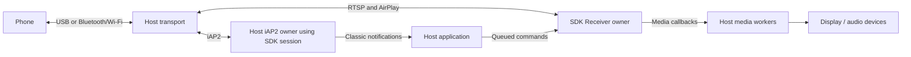

[English](architecture.md) | [简体中文](zh-CN/architecture.md)

# Receiver architecture

## Runtime at a glance

Bring up the physical link in the host and provide the SDK with transport and identity providers. The Receiver owns the AirPlay session. On D213, separate host owners run wired and wireless iAP2 and pass phone notifications to the application. The Receiver returns encoded video and negotiated audio to media backends. Commands travel back through the Receiver owner.

The public configuration used by the Linux simulator, generic RT-Thread headless example and D213 is explained in [Receiver integration](receiver-api.md). Only the host supplies hardware drivers and UI policy.

## Directory responsibilities

| Path | Responsibility |
| --- | --- |
| `include/rtcp/` | Public platform seams, errors, receiver lifecycle and state |
| `core/` | Portable protocol state machines and media processing |
| `runtime/receiver.c` | Receiver allocation, start, poll, stop, destroy and state notification |
| `port/linux/` | POSIX clock, entropy, sockets and synchronization |
| `port/rtthread/` | Generic RT-Thread clock, sockets and OS services |
| `port/luban-lite/` | Integration documentation; no board implementation sources |
| `examples/linux_sim/` | Foreground headless protocol bench using Receiver |
| `examples/rtthread_app/` | Compatibility build/include entry and historical integration reference |
| `third_party/` | Separately licensed dependencies and their original notices |

The Luban-Lite host owns its `app/`, `platform/` and `ui/` under `application/rt-thread/rtcarplay/`. The UI uses request/snapshot APIs; the manager owns connection workers, pairing/file operations and audio-test scheduling without an LVGL dependency. SDK SCons/Kconfig own only generic library code and switches. The host selects and builds all hardware adapters. Legacy example composition entries report a migration error; see [host migration](luban-lite-migration.md).

## Ownership and execution

A Receiver belongs to one lifecycle/poll thread. It owns its RTSP server, listening socket and protocol endpoints. It creates no worker and requires no framebuffer, sound device or touch controller. The host owns radio activation, USB enumeration policy, pairing provider contexts, media devices and worker scheduling. It must queue operations from UI/input threads to the owner. Callback contexts and OS/network tables remain borrowed until Receiver destruction. The [lifecycle contract](lifecycle-and-ownership.md) specifies reentrancy and buffer lifetimes.

The host RT-Thread composition owns a poll worker, touch queue, mDNS responder and browser. Receiver calls stay on its poll owner; commands are queued and cross-thread diagnostics copy published snapshots. USB, wireless iAP2, touch, audio output, video and microphone workers retain resources until retirement is acknowledged. The host snapshot contract records contention, timeout and retry behavior. Host tests model scheduler/device behavior; physical acceptance remains separate.

## Separate readiness states

Transport connection means an RTSP client socket exists. Authentication means Pair-Verify has installed ControlCipher. Session establishment means RECORD was accepted. Video readiness means a negotiated Screen endpoint exists; it does not mean a decoded frame was displayed. Audio readiness means at least one negotiated audio endpoint exists; it does not prove audible playback. Input readiness means the encrypted event channel is attached. Physical Bluetooth/USB connectivity and iAP2/MFi authentication remain separate transport/application diagnostics.

## Media and protocol boundaries

The transitional Luban-Lite video backend never reads or writes the host UI alpha. A stopped backend can register `carplay_video_sink_set_display_observer()` with a borrowed callback/context. The decoder worker reports the first successfully latched frame once; stop reports inactive only after the worker has finished and the video layer is disabled. Registration survives restarts and must be changed only under serialized lifecycle ownership while stopped. The reference host explicitly registers its full-screen launcher policy in `ui/video_layer_policy.c`; a host with persistent vehicle or safety HMI supplies its own policy. Missing registration preserves the UI layer. Failed presentation does not authorize HMI handoff.

Existing callbacks keep their exact contracts: video supplies borrowed Annex-B H.264; audio supplies decrypted LPCM or encoded AAC/Opus plus negotiated format, RTP timestamp and arrival time. `include/rtcp/media.h` now defines the actual `rtcp_media_backend_t` accepted by Receiver, including microphone, selective stop, resource modes, ducking and volume callbacks. Internal type names alias these public definitions; no encoded metadata is discarded or reinterpreted. The board worker still owns decoding, jitter queues, mixing, device configuration and output. HID, Siri and tunneled iAP2 output have public owner-thread Receiver functions. The old low-level configuration can be migrated through `rtcp/receiver_compat.h`.

cherryusb-ipheth remains an independent library. It owns Apple Ethernet class/network adaptation, not CarPlay pairing, USBMUX sessions or device-wide configuration selection. No reverse dependency on rt-carplay is introduced. Android Auto, CarLife and CarLink are outside scope.

## Validation boundaries

Host tests exercise real loopback sockets, cryptographic pairing and encrypted media independently of hardware. D213 compilation/packaging proves source and linker integration only. Physical USB reconnect, radio pairing, first displayed frame, HMI restoration, speaker output and microphone capture require separately recorded hardware results. See [Receiver API](receiver-api.md) for the implemented lifecycle and its current migration limits.
