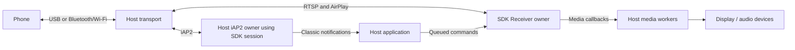

[English](../architecture.md) | [简体中文](architecture.md)

# Receiver 架构

## 运行结构

宿主负责建立物理链路，并向 SDK 提供传输及身份接口。Receiver 管理 AirPlay 会话。D213 宿主分别运行有线和无线 iAP2，将手机通知交给应用。Receiver 向媒体后端交付编码视频及已协商的音频，应用命令则提交给 Receiver 所属线程。

Linux 模拟器、通用 RT-Thread 无界面示例和 D213 使用的公共配置见 [Receiver 接入](receiver-api.md)。硬件驱动和 UI 策略由宿主管理。

## 目录职责

| 路径 | 职责 |
| --- | --- |
| `include/rtcp/` | 公共平台接口、错误码、Receiver 生命周期与状态 |
| `core/` | 可移植的协议状态机与媒体处理 |
| `runtime/receiver.c` | Receiver 分配、启动、轮询、停止、销毁与状态通知 |
| `port/linux/` | POSIX 时钟、熵源、Socket 与同步 |
| `port/rtthread/` | 通用 RT-Thread 时钟、Socket 与 OS 服务 |
| `port/luban-lite/` | 集成文档，不包含板级实现源码 |
| `examples/linux_sim/` | 使用 Receiver 的前台 Headless 协议测试程序 |
| `examples/rtthread_app/` | 兼容构建与头文件入口，以及历史集成参考 |
| `third_party/` | 独立许可的依赖及其原始声明 |

Luban-Lite 宿主在 `application/rt-thread/rtcarplay/` 下拥有 `app/`、`platform/` 和 `ui/`。UI 使用请求、快照 API；管理器在不依赖 LVGL 的条件下拥有连接 Worker、配对文件操作和音频测试调度。SDK SCons、Kconfig 只拥有通用库代码与开关。所有硬件适配由宿主选择并编译。旧示例组合入口会报告迁移错误；参见 [宿主迁移](luban-lite-migration.md)。

## 所有权与执行模型

Receiver 由一个生命周期与轮询线程独占。它拥有 RTSP Server、监听 Socket 和协议端点，不创建 Worker，也不要求帧缓冲、声卡或触摸控制器。宿主拥有无线激活、USB 枚举策略、配对 Provider 上下文、媒体设备与 Worker 调度。UI 与输入线程的操作必须排队交给 Owner。回调上下文及 OS、网络接口表在 Receiver 销毁前始终由外部持有。[生命周期契约](lifecycle-and-ownership.md)说明重入规则和缓冲区有效期。

宿主 RT-Thread 组合实现拥有 Poll Worker、触摸队列、mDNS Responder 与 Browser。Receiver 调用留在 Poll Owner；命令排队，跨线程诊断复制已发布快照。USB、无线 iAP2、触摸、音频输出、视频和麦克风 Worker 均保留资源，直到确认退出。宿主快照契约记录竞争、超时和重试行为。Host 测试模拟调度与设备行为；实机验收单独报告。

## 分离的就绪状态

Transport Connected 表示 RTSP 客户端 Socket 存在。Authenticated 表示 Pair-Verify 已安装 ControlCipher。Session Established 表示 RECORD 已被接受。Video Ready 表示已协商的 Screen 端点存在，不表示已经显示解码帧。Audio Ready 表示至少存在一个已协商音频端点，不证明能够听到声音。Input Ready 表示加密 Event Channel 已连接。物理 Bluetooth、USB 连接和 iAP2、MFi 认证仍由独立的传输与应用诊断报告。

## 媒体与协议边界

过渡期 Luban-Lite 视频后端不读取或修改宿主 UI Alpha。后端停止时可通过 `carplay_video_sink_set_display_observer()` 注册借用的回调与上下文。Decoder Worker 只在首次成功锁存视频帧后报告一次呈现；停止接口在 Worker 完成且 Video Layer 已禁用后才报告 inactive。注册跨重启保留，只能由串行生命周期 Owner 在后端停止时修改。参考宿主在 `ui/video_layer_policy.c` 中显式注册全屏启动页策略；保留车辆或安全 HMI 的宿主应提供自己的策略。不注册时保留 UI Layer。呈现失败不允许交接 HMI。

现有回调保持原有契约：视频提供借用的 Annex-B H.264；音频提供解密后的 LPCM 或编码 AAC、Opus，并携带协商格式、RTP 时间戳和到达时间。`include/rtcp/media.h` 现已定义 Receiver 实际接收的 `rtcp_media_backend_t`，包含麦克风、选择性停止、资源模式、Ducking 及音量回调。内部类型名作为这些公共定义的别名，不丢弃或重新解释编码元数据。板级 Worker 继续拥有解码、Jitter Queue、混音、设备配置与输出。HID、Siri 和隧道 iAP2 输出已提供在 Owner 线程中调用的公共 Receiver 函数。旧低层配置可通过 `rtcp/receiver_compat.h` 迁移。

cherryusb-ipheth 继续作为独立库。它拥有 Apple Ethernet Class 与网络适配，不拥有 CarPlay 配对、USBMUX Session 或设备级 USB 配置选择。本轮不引入对 rt-carplay 的反向依赖。Android Auto、CarLife 和 CarLink 不在范围内。

## 验证边界

Host 测试通过真实 Loopback Socket、密码学配对和加密媒体验证协议，不依赖硬件。D213 编译与打包只证明源码和链接集成。物理 USB 重插、无线配对、首帧显示、HMI 恢复、扬声器输出与麦克风采集需要单独记录实机结果。已实现的生命周期和当前迁移限制见 [Receiver API](receiver-api.md)。
